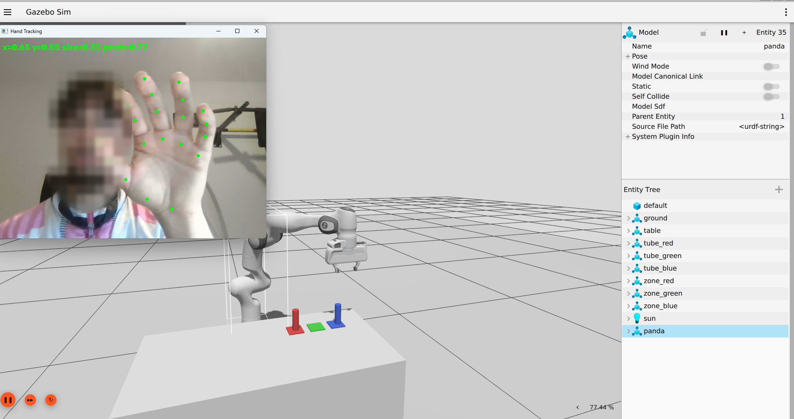

# Panda Hand Teleoperation for Lab Automation

Control a simulated Franka Emika Panda robot arm with your bare hand through a regular webcam, and sort sample tubes by color in a lab scene.

Move your hand and the gripper follows. Pinch thumb and index finger and the gripper closes.



## Why

Telemanipulation is used wherever people should not or cannot handle samples directly, for example in sterile areas, with hazardous substances or in pharmaceutical quality control. This project explores a low-cost version of that idea: no data glove, no VR controller, only a webcam and AI-based hand tracking.

## Features

- Real-time hand tracking with MediaPipe (21 hand landmarks)
- Cartesian real-time control of the arm with MoveIt Servo
- Gripper control by pinch gesture, with hysteresis to prevent flickering
- Physics simulation in Gazebo Harmonic with ros2_control
- Lab scene with a table, three colored sample tubes and matching target zones
- Stable grasping via Gazebo's DetachableJoint system
- Safety workspace box and speed limit around the start pose
- Single launch command for simulation, controllers, Servo and the teleoperation node

## Architecture

```
 Windows                              WSL2 (Ubuntu 24.04, ROS 2 Jazzy)
┌──────────────────────┐   UDP     ┌───────────────────────────────────────────────┐
│ Webcam               │  x, y,    │ hand_servo.py (ROS 2 node)                    │
│   ↓                  │  size,    │   • smoothing + calibration                   │
│ MediaPipe Hand       │  pinch    │   • hand offset → target pose → P-controller  │
│ Landmarker           │ ───────▶  │   • pinch → gripper action + attach/detach    │
│ hand_sender.py       │           │        │                     │                │
└──────────────────────┘           │        ▼ TwistStamped        ▼ GripperCommand │
                                   │   MoveIt Servo        panda_hand_controller   │
                                   │        │ JointTrajectory     │                │
                                   │        ▼                     ▼                │
                                   │   ros2_control  ◀── gz_ros2_control ──▶ Gazebo│
                                   └───────────────────────────────────────────────┘
```

Hand tracking runs natively on Windows because webcam access from WSL2 is cumbersome. The landmarks are sent as small JSON packets over UDP to the ROS 2 side, which keeps the sensor PC and the robot PC cleanly separated.

## How it works

**Hand to arm mapping.** When the hand is first detected, the node stores the hand position and the current gripper position as the zero point. From then on, hand movement left/right and up/down moves the target position of the gripper. The apparent hand size in the image (wrist to middle finger base) is used as a rough depth estimate for forward/backward. A proportional controller turns the distance between target and current gripper position into a velocity command for MoveIt Servo, clamped to a maximum speed.

**Gripper.** The pinch value is the distance between thumb tip and index finger tip, divided by the hand size so it does not depend on the distance to the camera. Below one threshold the gripper closes, above a second, higher threshold it opens.

**Grasping.** Friction-only grasping is unstable in physics simulation. When the gripper closes, the node looks for the tube closest to the fingers and attaches it to the hand with a Gazebo DetachableJoint. Opening the gripper detaches it again.

## Tech stack

ROS 2 Jazzy · MoveIt 2 (Servo) · Gazebo Harmonic · ros2_control / gz_ros2_control · ros_gz_bridge · tf2 · Python · MediaPipe · OpenCV · WSL2

## Repository structure

```
config/    controller settings and initial joint positions
launch/    gazebo.launch.py (simulation), teleop_gz.launch.py (everything)
scripts/   hand_servo.py (ROS 2 teleoperation node)
urdf/      Panda model for Gazebo, grasp joints
windows/   hand_sender.py (webcam + MediaPipe + UDP), hand_test.py
worlds/    lab.sdf (table, tubes, target zones)
```

## Setup

Tested on Windows 11 with WSL2 (Ubuntu 24.04) and an Intel Iris Xe GPU.

**ROS side (WSL2)**

```bash
# ROS 2 Jazzy: https://docs.ros.org/en/jazzy/Installation.html
sudo apt install ros-jazzy-moveit ros-jazzy-moveit-servo \
  ros-jazzy-moveit-resources-panda-moveit-config ros-jazzy-ros-gz \
  ros-jazzy-gz-ros2-control ros-jazzy-ros2-controllers ros-jazzy-xacro

mkdir -p ~/lab_ws/src && cd ~/lab_ws/src
git clone https://github.com/KhaledAbuMustafa/panda-hand-teleop.git lab_teleop
cd ~/lab_ws && colcon build --symlink-install
source install/setup.bash
```

GPU acceleration in WSL2: if `glxinfo -B` shows `llvmpipe`, add `export GALLIUM_DRIVER=d3d12` to `~/.bashrc`.

**Hand tracking side (Windows, Python 3.12)**

```powershell
cd windows
py -3.12 -m venv .venv
.\.venv\Scripts\Activate.ps1
pip install mediapipe opencv-python
curl.exe -L -o hand_landmarker.task https://storage.googleapis.com/mediapipe-models/hand_landmarker/hand_landmarker/float16/latest/hand_landmarker.task
```

Set `WSL_IP` in `windows/hand_sender.py` to the output of `hostname -I` in WSL.

## Usage

```bash
# WSL2
ros2 launch lab_teleop teleop_gz.launch.py
```

```powershell
# Windows, inside the windows/ folder with the venv activated
python hand_sender.py
```

Hold your hand still in the middle of the camera image until the node logs `Kalibriert` (calibrated), then move slowly. Pinch to grasp, open your hand to release.

## Limitations and next steps

- Depth from a single camera is only approximate, which makes precise positioning harder
- Gripper orientation is fixed, only position is controlled
- Possible next steps: palm center instead of wrist for less jitter, a "clutch" gesture to reposition the hand, camera-based automatic sorting, logging, and an OPC UA interface for status and start/stop

## License

MIT
